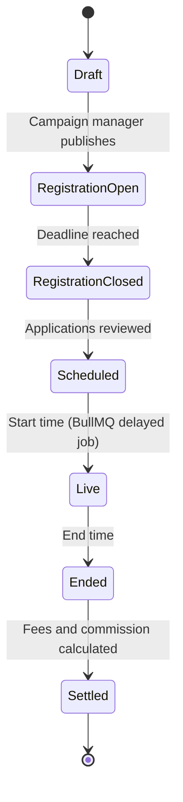
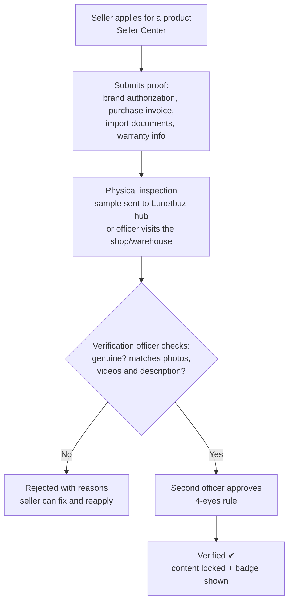
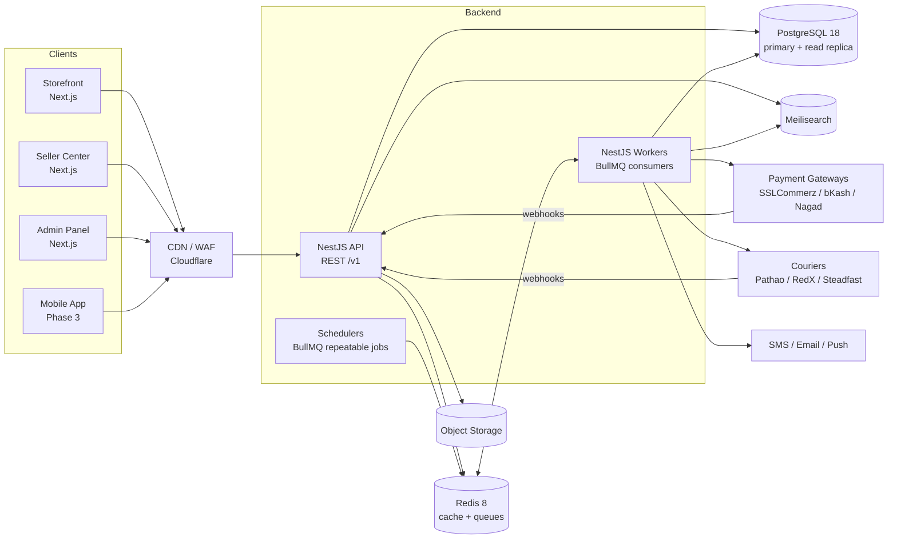
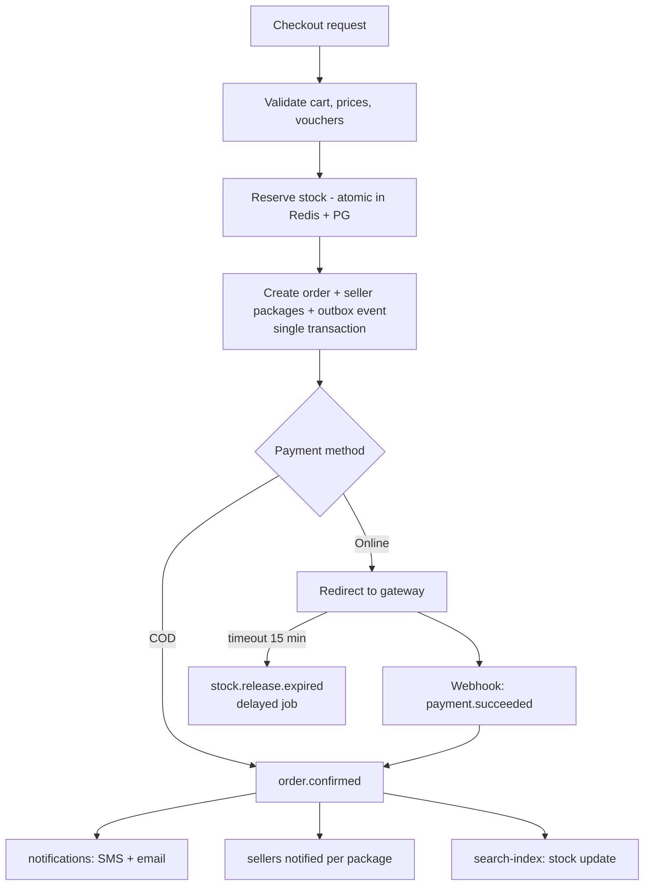
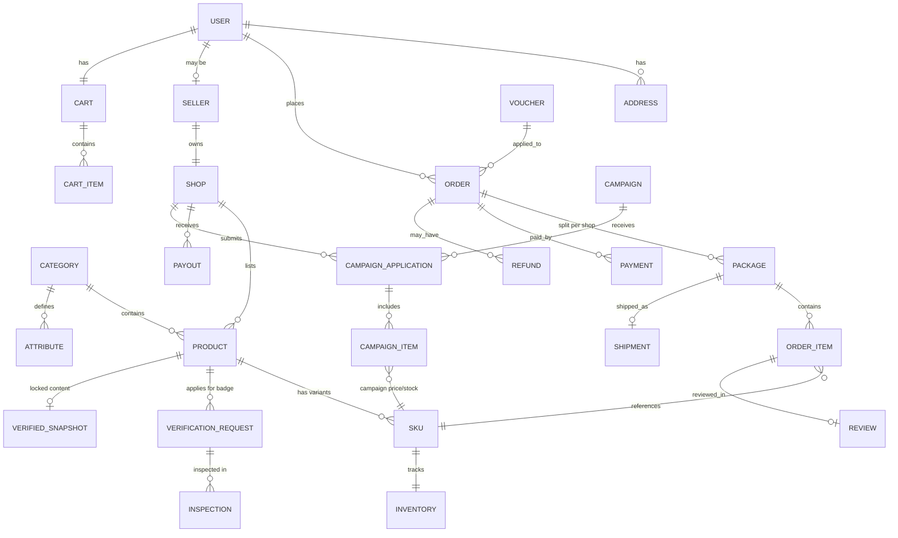
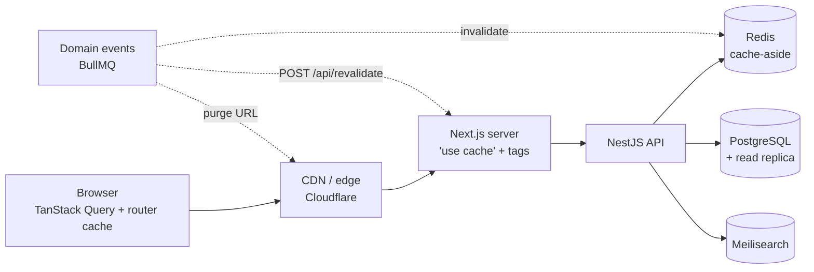

# Lunetbuz — Technical & Product Proposal

> A multi-vendor e-commerce marketplace for Bangladesh, inspired by Daraz.

| | |
|---|---|
| **Project** | Lunetbuz |
| **Document** | Proposal v1.0 |
| **Date** | October 2026 |
| **Stack** | Next.js · NestJS · BullMQ · PostgreSQL |

---

## 1. Executive Summary

Lunetbuz is an online marketplace where many independent sellers list products and Bangladeshi customers can browse, compare, buy and get them delivered anywhere in the country. Like Daraz, Lunetbuz runs the platform (catalog, checkout, payments, logistics and trust & safety) and earns commission and fees from sellers.

What we plan to do differently:

- **Lunetbuz Verified Badge (not offered by Daraz):** our team physically checks a product and confirms it is 100% genuine and exactly as shown. After that, its photos, videos and description are locked, so customers can trust them completely (see §4.6).
- **Open campaign engine:** Lunetbuz runs sales, fests and seasonal events (11.11, Eid, Pohela Boishakh, Black Friday and more), and any eligible shop can apply to join with its products (see §4.5).
- **Local payments from day one:** Cash on Delivery (COD), bKash, Nagad, Rocket, and cards through a local gateway (SSLCommerz / aamarPay).
- **Bangla-first UX:** full Bangla and English support, and pages that load fast on low-end Android phones over 3G/4G.
- **Seller-friendly:** simple onboarding, transparent commission, and fast weekly payouts to bKash or a bank account.
- **Built to scale for campaigns:** an event-driven backend that can absorb 11.11 and Eid flash-sale traffic spikes.

---

## 2. Goals & Scope

### 2.1 Goals
1. Launch a working marketplace (MVP) in about 6 months.
2. Support at least 500 sellers and 100k SKUs at launch, with an architecture that grows to 1M+ SKUs.
3. Handle **5,000 concurrent users** and **50+ orders/second** during flash sales without overselling.
4. Keep p95 API latency **< 300 ms** and mobile LCP **< 2.5 s**.

### 2.2 Phased Scope

| Phase | Scope |
|---|---|
| **MVP (Phase 1)** | Customer storefront, Seller Center, Admin panel, catalog & search, cart & checkout, COD + bKash + SSLCommerz, order split per seller, 1–2 courier integrations, reviews, vouchers, SMS/email notifications, Bangla/English, **campaign engine (sales & fests with shop applications)**, **Lunetbuz Verified Badge** |
| **Phase 2** | Flash sales with Redis stock reservation, advanced campaign tools (bundles, free-shipping campaigns, campaign ads), wallet & refunds to wallet, Nagad/Rocket, more couriers, Q&A, follow store, seller analytics, push notifications, PWA |
| **Phase 3** | Native mobile apps (React Native), live chat (buyer ↔ seller), recommendations, LunetMall (brand-verified stores), ads for sellers, loyalty coins, BNPL/EMI |

### 2.3 Non-Goals (for now)
- Cross-border / global shipping.
- Running our own delivery fleet (we integrate with 3PL couriers instead).
- Microservices from day one (we start with a modular monolith; see §6).

---

## 3. User Roles

| Role | Description |
|---|---|
| **Customer** | Browses, buys, reviews, requests returns |
| **Seller** | Owns a shop and manages products, stock, orders and payouts |
| **Admin / Ops** | Manages catalog taxonomy, approves sellers, moderates, runs campaigns, resolves disputes, finance |
| **Campaign Manager** | Creates sales and fests, reviews shop applications |
| **Verification Officer** | Inspects products for the Verified Badge; approves, rejects, or revokes it |
| **Customer Support** | Read access to orders, can raise refunds and tickets |
| **Courier (system)** | External 3PL that receives shipments and sends tracking webhooks |

Access is controlled with RBAC: roles map to permissions, and admin staff get fine-grained permissions such as `catalog.write` and `finance.payout.approve`.

---

## 4. Feature Set

### 4.1 Customer Storefront (`lunetbuz.com`)
- **Home:** banners, flash-sale countdown, categories, "Just for You" feed.
- **Discovery:** category tree, full-text search with typo tolerance (Bangla + English), filters (price, brand, rating, location, free shipping), sorting.
- **Product page (PDP):** image gallery, variants (size/color), price/discount, stock, seller info and rating, delivery estimate by location, reviews with photos, Q&A.
- **Cart:** multi-seller cart grouped by shop, with shop vouchers and platform vouchers.
- **Checkout:** saved addresses (Division → District → Upazila/Thana → Area), shipping fee calculated by zone, payment method selection.
- **Payments:** COD, bKash, Nagad, Rocket, Visa/Mastercard/Amex through SSLCommerz.
- **Account:** orders, tracking timeline, returns/refunds, wishlist, followed stores, wallet, notifications.
- **Auth:** phone + OTP (primary), email + password, Google/Facebook login.
- **i18n:** Bangla and English, with BDT formatting (৳).

### 4.2 Seller Center (`seller.lunetbuz.com`)
- Registration and KYC (NID, trade license, bank/bKash account), with admin approval.
- Shop profile, logo, banner, policies.
- Product management: create/edit, variants, bulk upload by CSV/XLSX, image upload, and a QC status (pending/approved/rejected).
- Inventory and pricing, including special prices with a date range.
- Orders: accept, pack, print invoice/shipping label, hand over to courier, cancel.
- Returns management.
- Campaign registration: browse upcoming sales/fests and apply with selected products (§4.5).
- Apply for the **Lunetbuz Verified Badge** per product and track its status (§4.6).
- Finance: statement, commission breakdown, payout history.
- Analytics: sales, traffic, conversion, top products.

### 4.3 Admin Panel (`admin.lunetbuz.com`)
- Category tree and category-specific attributes.
- Seller approval/suspension, product QC moderation.
- Commission rules (per category / per seller).
- Vouchers; campaign creation and application review (§4.5).
- Verification queue: assign inspections, approve/reject/revoke badges, audit history (§4.6).
- CMS: home banners, landing pages.
- Order management, dispute & refund workflow.
- Payout approval and finance reports.
- Review moderation, fraud flags (COD abuse, fake reviews).
- Audit log of all admin actions.

### 4.4 Logistics
- Integrations through a common `CourierProvider` interface: **Pathao, RedX, Steadfast, Paperfly** (MVP: 2 of these).
- Shipping fee rules by zone (inside Dhaka, Dhaka suburbs, outside Dhaka) and by weight.
- Tracking status received from courier webhooks and pushed to the customer.
- COD reconciliation: compare courier remittance against expected COD amounts.

### 4.5 Campaigns: Sales, Fests & Events

Lunetbuz staff can start a new sales event at any time, and shops **apply to join it with their products**.

**Campaign types**

| Type | Example |
|---|---|
| Mega sale | 11.11, 12.12, Black Friday, anniversary sale |
| Festival (fest) | Eid fest, Pohela Boishakh, Puja fest, Winter fest |
| Flash sale | Hourly time slots with limited stock and a deep discount |
| Category / brand day | "Electronics Day", "Brand X Week" |
| Clearance / special | Free-shipping week, "Under ৳99", Verified-only sale |

**Lifecycle**



**What the campaign manager configures**
- Name, banner, landing page, campaign type, registration window, and the live start/end time.
- Eligibility rules: allowed categories, minimum shop rating, maximum cancellation rate, and whether the campaign is open only to **Verified** products.
- Product rules: minimum discount % (for example ≥ 15%), minimum campaign stock, and a maximum number of products per shop.
- Commercial terms: campaign commission or participation fee, and who funds vouchers (platform or seller).
- Slots (for flash sales): time slots with a cap on the number of products per slot.

**How a shop applies**
1. A seller opens **Seller Center → Campaigns** and sees the campaigns that are open for registration.
2. The seller selects products/SKUs and enters a **campaign price** and **campaign stock** for each.
3. The system checks the rules automatically and shows any problems straight away (discount too small, not enough stock, category not allowed).
4. The application goes to the campaign manager, who approves or rejects each product.
5. Approved products get their campaign price applied automatically when the campaign goes live, and restored when it ends. Both happen through scheduled BullMQ jobs.

**Fair-pricing rule (protection against fake discounts):** the discount is calculated against the product's **lowest price in the last 30 days**, not against a price the seller raised just before the sale. This prevents the "inflate the price, then discount it" trick and protects customer trust.

**What customers see:** campaign landing pages with countdowns, a campaign tag on product cards and product pages, a "Verified only" filter, and campaign vouchers.

### 4.6 Lunetbuz Verified Badge (our key differentiator)

The **Lunetbuz Verified Badge** is a product-level guarantee. When a product shows this badge, Lunetbuz has **physically checked** it and confirms that:
- the product is **100% original and genuine** (not fake, not a copy), and
- it is **exactly as shown** in its photos, videos and description.

Because the listing is locked after verification, the seller cannot change what the customer sees. **Customers can trust a Verified product completely.**

#### How verification works



1. **Apply:** the seller chooses a product and clicks "Apply for Verified Badge". The shop must be in good standing (KYC done, no recent counterfeit strikes).
2. **Proof:** the seller uploads supporting documents such as brand authorization or a distributor letter, purchase or import invoices, and warranty cards.
3. **Inspection:** a Lunetbuz verification officer examines the real item, either at a Lunetbuz hub or at the seller's warehouse. The officer compares it item by item against the listing's photos, videos, description and specifications, and records their own inspection photos as evidence.
4. **Approval:** a second officer must approve before the badge is granted, so no single person can approve alone.
5. **Lock & publish:** the product's content is **locked** and the badge appears everywhere the product appears.

#### What gets locked

| Field | After verification |
|---|---|
| Photos & videos | 🔒 Locked |
| Title & description | 🔒 Locked |
| Specifications / attributes (brand, model, material, size, etc.) | 🔒 Locked |
| Category | 🔒 Locked |
| Verified variants (e.g. specific colors/sizes) | 🔒 Locked |
| **Price** | ✅ Seller can update |
| **Stock quantity** | ✅ Seller can update (needed to restock; this is not content) |

- **New variants** a seller adds later are *not* verified. They appear without the badge until they are verified separately.
- **To change locked content** (for example a new product photo or packaging), the seller submits a **change request**. The live, verified version stays unchanged while the new version is re-verified. If approved, the new version replaces the old one. The seller can never silently edit a verified listing.

#### Keeping the badge trustworthy
- **Random audits:** officers make "mystery shopper" test purchases of verified products and recheck stock at any time.
- **Complaint trigger:** if a customer return or complaint says the product was "not genuine" or "not as described", the badge is **suspended** right away while we investigate.
- **Revocation & penalties:** if a verified product is found to be fake or different from the listing, the badge is removed, the shop gets a strike, and repeated strikes lead to suspension and possible legal action.
- **Periodic re-verification:** badges expire after a set period (for example 12 months) and must be renewed.

#### Customer guarantee
Every verified product is covered by a **"100% Genuine or Money Back" guarantee**. If a customer receives a verified product that is not genuine or not as shown, they get a full refund (an extra compensation amount is a business decision we can make later). The cost is recovered from the seller.

#### Where customers see it
- A ✔ **Lunetbuz Verified** badge on product cards, product pages, cart and order pages.
- A "Verified only" filter in search and categories.
- A count on the shop's page, for example "42 Verified products".
- A "What does Verified mean?" explainer page.

#### Business model (options)
A per-product verification fee, a monthly "Verified Seller" subscription, or free for the first N products during launch. Verified products can also get better ranking in search and campaigns.

#### Technical enforcement
- The **catalog service** rejects any change to a locked field on a product whose `verification_status = VERIFIED`, with a clear error.
- A **Postgres trigger** enforces the same rule as a second layer of protection. Only the verification module can bypass it (through a transaction-scoped setting), so a bug or a direct database edit cannot silently change verified content.
- A **verified snapshot** stores the approved title, description, attributes and the **SHA-256 hash of each image/video**. Media is stored under immutable object keys (S3 Object Lock optional). Nightly jobs check that the live content still matches the snapshot.
- Every verification action is written to the audit log, together with inspection evidence (officer photos, notes, documents).

---

## 5. Technology Stack

Every runtime and framework is on its **current LTS / latest stable** line. Pin exact patch versions when we scaffold the project.

| Layer | Technology | Version (target) | Notes |
|---|---|---|---|
| Runtime | **Node.js** | **24.x LTS** | Active LTS; used by both web and API |
| Language | TypeScript | 5.x | Strict mode, shared types across apps |
| Package manager | pnpm | 10.x | Workspaces |
| Monorepo | Turborepo | 2.x | Build caching, task pipelines |
| **Frontend** | **Next.js** | **16.x** | App Router, React Server Components, ISR, Server Actions |
| UI library | React | 19.x | |
| Styling | Tailwind CSS + shadcn/ui | 4.x | Accessible components, design tokens |
| Client data | TanStack Query | 5.x | Cart, account, seller dashboards |
| i18n | next-intl | latest | Bangla / English |
| **Backend** | **NestJS** | **11.x** | Fastify adapter, modular architecture |
| Validation | class-validator / Zod | latest | DTO validation |
| ORM | Prisma | 6.x | Type-safe, migrations (Drizzle is an alternative) |
| **Database** | **PostgreSQL** | **18.x** | Primary data store |
| **Queue / events** | **BullMQ** | **5.x** | Jobs, events, schedulers, flows |
| Queue store / cache | Redis (or Valkey) | 8.x | BullMQ backend, caching, rate limiting, sessions |
| Search | Meilisearch | 1.x | Fast, typo-tolerant; move to OpenSearch at larger scale |
| Object storage | S3-compatible (AWS S3 / Cloudflare R2) | — | Product images, invoices |
| CDN / images | Cloudflare / CloudFront + Next Image | — | WebP/AVIF resizing |
| Auth | JWT (access + refresh), Argon2 | — | Phone OTP via SMS gateway |
| Observability | OpenTelemetry, Prometheus, Grafana, Loki, Sentry | — | Traces, metrics, logs, errors |
| Containers / CI | Docker, GitHub Actions | — | |
| Testing | Vitest/Jest, Supertest, Playwright | — | Unit, integration, E2E |

**Third-party services (Bangladesh):** SSLCommerz, bKash Tokenized Checkout, Nagad, Rocket; SMS through BulkSMSBD / SSL Wireless; couriers Pathao, RedX, Steadfast, Paperfly.

---

## 6. System Architecture

### 6.1 Approach: Modular Monolith → Services
We start with a **NestJS modular monolith** with strict module boundaries (each module owns its own tables and talks to other modules through services or events, never through each other's tables), plus a separate **worker process** that consumes BullMQ queues. This gives us microservice-style decoupling without the operational cost on day one. When a module needs to scale on its own (for example search or notifications), we can extract it, because it already talks over events.

### 6.2 High-Level Diagram



### 6.3 Monorepo Layout

```
lunetbuz/
├── apps/
│   ├── web/            # Customer storefront (Next.js)
│   ├── seller/         # Seller Center (Next.js)
│   ├── admin/          # Admin panel (Next.js)
│   ├── api/            # NestJS HTTP API
│   └── worker/         # NestJS BullMQ workers + schedulers
├── packages/
│   ├── ui/             # Shared React components (shadcn-based)
│   ├── db/             # Prisma schema, migrations, client
│   ├── contracts/      # Shared DTOs/types, event payload schemas
│   ├── queue/          # Queue names, job types, BullMQ helpers
│   ├── config/         # ESLint, TS config, Tailwind preset
│   └── sdk/            # Typed API client generated from OpenAPI
├── infra/              # Docker, compose, IaC (Terraform)
└── turbo.json
```

### 6.4 Backend Modules (NestJS)

| Module | Responsibility |
|---|---|
| `auth` | OTP, login, JWT, refresh, social login, RBAC guards |
| `users` | Profiles, addresses |
| `sellers` | Onboarding, KYC, shops, seller staff |
| `catalog` | Categories, attributes, brands, products, SKUs, QC |
| `inventory` | Stock levels, reservations, stock movements |
| `pricing` | Base/special prices, campaign prices |
| `search` | Indexing, query API (Meilisearch) |
| `cart` | Cart, cart validation |
| `promotions` | Vouchers |
| `campaigns` | Sales/fests, registration, shop applications, rule checks, scheduled price switch |
| `verification` | Verified Badge applications, inspections, approvals, content lock, snapshots, audits, revocation |
| `checkout` | Order creation, shipping-fee calculation |
| `orders` | Order lifecycle, split into seller packages |
| `payments` | Gateway adapters, webhooks, refunds |
| `shipping` | Courier adapters, tracking |
| `reviews` | Ratings, reviews, Q&A |
| `wallet` | Customer wallet, ledger |
| `finance` | Commission, seller statements, payouts |
| `notifications` | SMS, email, push, in-app |
| `cms` | Banners, landing pages |
| `audit` | Admin action logs |

---

## 7. Event-Driven Design with BullMQ

### 7.1 Why BullMQ
- Reliable, Redis-backed job queues with retries, exponential backoff, delayed jobs, priorities and rate limiting.
- **Flows** (parent/child jobs) for multi-step processes such as order fulfilment.
- **Job schedulers** (repeatable jobs) for cron-style tasks.
- First-class TypeScript and NestJS integration (`@nestjs/bullmq`).

### 7.2 Reliable Event Publishing: Transactional Outbox
To avoid "DB committed but event lost" (or the reverse), domain events are written to an `outbox_events` table **in the same Postgres transaction** as the business change. An outbox relay then publishes them to BullMQ:

```mermaid
sequenceDiagram
    participant API as NestJS API
    participant PG as PostgreSQL
    participant Relay as Outbox Relay
    participant Q as BullMQ (Redis)
    participant W as Workers

    API->>PG: BEGIN; INSERT order; INSERT outbox_event(order.placed); COMMIT
    Relay->>PG: SELECT unpublished events (FOR UPDATE SKIP LOCKED)
    Relay->>Q: queue.add('order.placed', payload, {jobId: event.id})
    Relay->>PG: mark published
    Q->>W: deliver job
    W->>W: idempotent handler (dedupe by event id)
```

- `jobId = event.id` makes enqueueing idempotent.
- Consumers are idempotent (they keep a `processed_events` table or rely on natural keys).
- Failed jobs retry with exponential backoff. After N attempts they move to a **dead-letter queue** and alert on-call.

### 7.3 Queue Catalog

| Queue | Example jobs | Concurrency notes |
|---|---|---|
| `orders` | `order.placed`, `order.cancelled`, `order.split` | Medium |
| `payments` | `payment.verify`, `payment.refund`, `payment.reconcile` | Gateway rate-limited |
| `inventory` | `stock.reserve`, `stock.release`, `stock.release.expired` | Serialized per SKU |
| `shipping` | `shipment.create`, `shipment.track.poll` | Rate-limited per courier |
| `notifications` | `sms.send`, `email.send`, `push.send` | High, rate-limited per provider |
| `search-index` | `product.upsert`, `product.delete` | Batched |
| `cache-invalidation` | `redis.purge`, `next.revalidate`, `cdn.purge` (see §11.3) | High, deduplicated per tag |
| `media` | `image.process` (resize, WebP/AVIF) | CPU-bound worker pool |
| `finance` | `commission.calculate`, `payout.generate`, `cod.reconcile` | Low, scheduled |
| `campaigns` | `registration.open/close`, `application.validate`, `campaign.start/end`, `price.apply/restore` | Delayed jobs |
| `verification` | `inspection.assign`, `badge.grant`, `badge.suspend`, `snapshot.integrity.check`, `badge.expiry.remind` | Low, scheduled audits |
| `catalog-import` | `bulk.upload.process` | Long-running, progress reported |

### 7.4 Core Domain Events

```
user.registered          seller.approved          product.approved
product.updated          stock.changed            cart.abandoned
order.placed             order.confirmed          order.cancelled
payment.initiated        payment.succeeded        payment.failed
package.ready_to_ship    shipment.created         shipment.delivered
return.requested         refund.processed         review.created
payout.generated         campaign.started         campaign.ended
campaign.registration_opened                      campaign.application_submitted
campaign.application_approved                     campaign.application_rejected
verification.requested   verification.approved    verification.rejected
verification.suspended   verification.revoked     product.content_locked
```

### 7.5 Example: Order Placement Flow



### 7.6 Flash-Sale Stock Protection
- Campaign stock is preloaded into Redis counters and decremented with an atomic Lua script (`DECRBY` only if the result stays ≥ 0), so stock can never be oversold.
- The reservation has a TTL. A delayed BullMQ job releases unpaid reservations.
- Postgres stays the source of truth and is updated asynchronously through the `inventory` queue.
- Per-user purchase limits and a rate limiter on the checkout endpoint.

### 7.7 Monitoring
- **Bull Board** dashboard (admin-only) to inspect queues, retry jobs and see failures.
- Prometheus metrics: queue depth, processing time, failure rate. Alerts on DLQ growth.

---

## 8. Data Model (High Level)



**Key design decisions**
- **Money** is stored as integer `paisa` (`BIGINT`) with a currency code. No floating point.
- **Order → Package split:** one customer order can contain items from several shops, and each shop fulfils its own package (as Daraz does).
- **Order item snapshots:** product name, price and attributes are copied at purchase time.
- **Ledgers** (wallet, seller finance) are append-only double-entry tables.
- **Price history** table: required for the campaign "lowest price in 30 days" rule.
- **Verification:** `products.verification_status` (`NONE / PENDING / VERIFIED / SUSPENDED / REVOKED / EXPIRED`), plus an immutable `verified_snapshots` record (content and media hashes) and append-only inspection evidence.
- **Category-specific attributes** are stored as `JSONB` with GIN indexes. Core fields stay as normal columns.
- **Soft deletes** and `created_at/updated_at` on every table. UUIDv7 primary keys (time-ordered, PG 18 native `uuidv7()`).
- **Address hierarchy** (Division/District/Upazila/Area) is seeded reference data.
- Partition large tables (`orders`, `order_items`, `outbox_events`) by month when needed.

---

## 9. API Design

- **REST** with a versioned prefix `/api/v1`, documented automatically through **OpenAPI/Swagger**. A typed client SDK is generated into `packages/sdk`.
- Separate route groups: `/v1/store/*` (customer), `/v1/seller/*`, `/v1/admin/*`, `/v1/webhooks/*`.
- **Auth:** short-lived JWT access token (15 min) plus a rotating refresh token in an httpOnly cookie. Phone OTP with resend throttling.
- **Authorization:** RBAC guards plus resource ownership checks (a seller can only touch their own shop's data).
- **Idempotency-Key** header on checkout and payment endpoints.
- **Rate limiting** with `@nestjs/throttler` on a Redis store.
- **Pagination:** cursor-based for feeds and lists.
- **Webhooks:** signature verification and replay protection for gateway and courier callbacks.

Example endpoints:

```
GET    /api/v1/store/products?category=&q=&sort=&cursor=
GET    /api/v1/store/products/:slug
POST   /api/v1/store/cart/items
POST   /api/v1/store/checkout            (Idempotency-Key)
GET    /api/v1/store/orders/:id/tracking
POST   /api/v1/seller/products
PATCH  /api/v1/seller/packages/:id/ready-to-ship
GET    /api/v1/seller/campaigns?status=registration_open
POST   /api/v1/seller/campaigns/:id/applications
POST   /api/v1/seller/products/:id/verification-requests
POST   /api/v1/seller/products/:id/change-requests      (locked content)
POST   /api/v1/admin/campaigns
PATCH  /api/v1/admin/campaign-applications/:id          (approve/reject)
POST   /api/v1/admin/verification-requests/:id/inspections
POST   /api/v1/admin/products/:id/verification/revoke
POST   /api/v1/webhooks/sslcommerz
```

---

## 10. Frontend Approach (Next.js)

- **Rendering strategy**
  - Home, category, product, shop and campaign pages are prerendered and cached on the server (`"use cache"` with named lifetimes and cache tags), and revalidated on `product.*` and `campaign.*` events. See §11.
  - Product pages (PDP) are static shells, with price and stock streamed through RSC + Suspense.
  - Cart, checkout and account pages are dynamic and client-heavy (TanStack Query).
  - Seller Center and Admin are authenticated SPAs-in-Next (no SEO needed).
- **Performance:** `next/image` with a CDN, route-level code splitting, minimal client JS on storefront pages, and Bangla fonts self-hosted with `next/font`.
- **SEO:** structured data (Product, BreadcrumbList, Review), sitemaps, canonical URLs, Bangla/English `hreflang`.
- **PWA (Phase 2):** installable, offline cart, push notifications.
- **Accessibility:** WCAG 2.2 AA target.

---

## 11. Caching Strategy

Caching happens in layers. Each layer has one job, a clear owner and a clear way to be invalidated. The guiding rule: **the more money or trust depends on a value, the shorter it is cached.** Prices at checkout, stock at checkout and badge status are never served from a stale cache.



### 11.1 Layers

| Layer | What is cached | How long | Invalidated by |
|---|---|---|---|
| **CDN / edge** | Hashed JS/CSS/fonts (immutable, 1 year), product images (resized WebP/AVIF), prerendered storefront HTML | Assets: forever (hashed names). HTML: follows Next.js `s-maxage` | New deploy (new hashes); URL purge on product removal |
| **Next.js server cache** (`"use cache"`) | Public storefront reads only: home page, categories, product details, shop profiles, campaign pages | Named profiles (§11.2) | **Tags**, called from the backend (§11.3) |
| **Next.js router cache** (browser) | Rendered pages and prefetched shells for back/forward and link navigation | The profile's `stale` time (30 s – 5 min) | Expires automatically. Revisits refetch. |
| **TanStack Query** (browser) | API responses per user session | Per-query tier (§11.4) | Mutations invalidate exact keys. Logout clears everything. |
| **Browser storage** | Session token and cart lines only, never prices | Session: until expiry. Cart: until checkout | Logout, checkout |
| **Redis (NestJS)** | Hot reads (product detail DTO, category tree, home blocks, shop summary), rate limits, OTP codes, sessions, flash-sale stock counters | 5–60 min TTL plus events | Domain events (cache-aside delete) |
| **PostgreSQL** | Read replica for listings and reports, materialized views for analytics | Replication lag (seconds), views refreshed hourly | — |
| **Meilisearch** | Search index (denormalized product cards) | Near real time | `search-index` queue on `product.*` events |

### 11.2 Server cache profiles (Next.js `cacheLife`)

| Profile | Used for | `stale` (browser) | `revalidate` (background refresh) | `expire` (hard limit) |
|---|---|---|---|---|
| `storefront` | Home page, listings | 60 s | 2 min | 1 h |
| `product` | Product detail page | 60 s | 5 min | 24 h |
| `campaign` | Campaign landing pages (time-sensitive prices) | 30 s | 1 min | 15 min |
| `reference` | Categories, shop profiles | 5 min | 1 h | 24 h |

These time limits are only a **safety net**. Freshness comes from event-driven tag invalidation (§11.3). Only data that is the same for every visitor is cached on the server. Anything user-specific (cart totals, account, portals) is fetched in the browser with the user's token, so it can never leak between users through a shared cache.

### 11.3 Event-driven invalidation (tags)

Every cached read carries a specific tag plus the collection tags it belongs to:

| Domain event | Tags invalidated | Mode |
|---|---|---|
| `product.updated` (content, after QC) | `product:<slug>`, `shop:<shopSlug>` | stale-while-revalidate |
| price / stock changed | `product:<slug>` | stale-while-revalidate |
| `campaign.started` / `campaign.ended` | `campaign:<slug>`, `campaigns`, `products`, `home` | stale-while-revalidate |
| `verification.revoked` / product banned / wrong price fixed | `product:<slug>`, `home` | **expire immediately** |
| shop suspended | `shop:<slug>`, `products`, `home` | **expire immediately** |
| category tree changed | `categories` | stale-while-revalidate |
| banner changed | `home` | stale-while-revalidate |

**Flow:**
1. The API commits the change and writes an outbox event (§7.2).
2. The `cache-invalidation` queue worker deletes the matching Redis keys.
3. The worker calls the frontend's `POST /api/revalidate` with the tags, authenticated by a shared secret and validated against the known tag list.
4. If the product was removed, the worker also purges its URL on the CDN.

"Stale-while-revalidate" means visitors keep getting the cached page while a fresh one is built, so a popular product edit never causes a traffic spike on the API. "Expire" is reserved for corrections that must not be shown again.

### 11.4 Client cache tiers (TanStack Query)

| Tier | Examples | Fresh for | Extra behavior |
|---|---|---|---|
| `static` | Delivery locations | Session | — |
| `reference` | Categories, roles, staff list | 10 min | — |
| `catalog` | Search results, reviews, Q&A, campaign list | 1 min | Next page is prefetched |
| `private` | Account, seller products, shop settings, payouts | 30 s | Cleared on logout or account switch |
| `live` | Seller/admin dashboards, order queues, tickets, verification queue | 10 s | Refetch on window focus, polled every minute while the tab is visible |
| `transactional` | Cart quote, checkout totals | 0 (always refetched) | Refetch on focus. Prices are re-quoted, never trusted from cache. |

Further rules:
- Mutations update or invalidate only the affected keys (for example, approving a campaign item invalidates that campaign and the dashboard count).
- The wishlist uses optimistic updates.
- Browser `fetch` uses `cache: "no-store"` so TanStack Query is the single client-side cache.

### 11.5 Backend cache (NestJS + Redis)

- **Cache-aside** through a small `CacheService`: keys follow the same tag scheme, for example `product:{id}:dto` and `home:blocks`. Each cached value records the tags it depends on, so one event deletes everything related.
- **Never cached:** checkout totals, payment state, stock at the moment of reservation (the atomic Redis counter is the source of truth, §7.6), permissions on write paths, and anything after a failed authorization check.
- **Stampede protection:** a single-flight lock per key, plus a small random jitter on TTLs so popular keys don't all expire at once.
- **HTTP headers from the API:** `Cache-Control: no-store` on authenticated responses, `ETag` on public catalog endpoints so the CDN and Next.js can revalidate cheaply.

### 11.6 Scaling the cache

- One Next.js instance: the default in-memory `"use cache"` store is enough.
- **Several instances (production):** configure a Redis-backed `cacheHandlers` in Next.js, so all instances share entries and a tag invalidation reaches every instance.
- Observability: hit and miss rates per layer (Redis `INFO`, Next.js cache logs, CDN analytics) on the Grafana dashboard, with an alert if the storefront API's request rate rises suddenly, which usually means the cache stopped hitting.

---

## 12. Non-Functional Requirements

| Area | Target / Approach |
|---|---|
| Availability | 99.9% monthly |
| Performance | p95 API < 300 ms; storefront LCP < 2.5 s on mid-range Android over 4G |
| Scalability | Stateless API/worker containers scaled horizontally; PG read replicas; Redis cluster later |
| Caching | Layered: CDN → Next.js server cache (tags) → TanStack Query tiers → Redis cache-aside → PG read replica. Event-driven invalidation. See §11. |
| Security | OWASP ASVS L2, Helmet, CSRF protection for cookie flows, input validation, secrets in a vault, WAF, dependency scanning |
| Payments | No card data stored; PCI scope delegated to the gateway (hosted checkout) |
| Privacy & compliance | Bangladesh Digital Commerce Guidelines 2021 (delivery timelines, refunds within the prescribed window), NBR VAT invoicing, Personal Data Protection compliance, consent for marketing SMS |
| Backups | PG PITR (WAL archiving), daily snapshots, quarterly restore drills |
| Observability | Distributed tracing across API → queue → worker, structured JSON logs, dashboards, on-call alerts |
| Fraud | COD risk scoring (failed-delivery history, phone verification), voucher-abuse limits, device fingerprinting |

---

## 13. Infrastructure & DevOps

- **Local development:** `docker compose up` brings up Postgres 18, Redis 8, Meilisearch, MinIO (S3) and Mailpit.
- **Environments:** `dev` → `staging` → `production`, each with isolated data.
- **Hosting (recommended):** AWS `ap-southeast-1` (Singapore) or `ap-south-1` (Mumbai) for low latency to Bangladesh:
  - ECS Fargate or EKS for API, workers and Next.js apps (Next.js can also run on Vercel)
  - RDS / Aurora PostgreSQL, ElastiCache (Redis/Valkey), S3 + CloudFront, or Cloudflare in front
  - A local BD data center is an option if data residency requires it.
- **CI/CD (GitHub Actions):** lint → type-check → test → build (Turborepo remote cache) → Docker image → deploy to staging → manual promotion to production.
- **Database migrations:** Prisma Migrate, run as a pre-deploy job. Expand/contract pattern for zero-downtime changes.
- **Infrastructure as Code:** Terraform.

---

## 14. Roadmap & Milestones

| Sprint (2 weeks) | Milestone |
|---|---|
| 1 | Monorepo, CI/CD, Docker env, design system, auth (OTP/JWT), DB baseline |
| 2–3 | Catalog (categories, attributes, products, SKUs), seller onboarding, image pipeline |
| 4 | Search (Meilisearch) + storefront home, listing pages, PDP |
| 5 | Cart, addresses, shipping-fee engine |
| 6–7 | Checkout, orders + package split, COD, SSLCommerz, bKash, outbox + BullMQ |
| 8 | Seller order fulfilment, courier integration #1, tracking |
| 9 | Notifications, reviews, vouchers, admin panel core |
| 10 | Finance: commission, statements, payouts; returns/refunds |
| 11 | Campaign engine (create, register, apply, rules, scheduled pricing) |
| 12 | Lunetbuz Verified Badge (applications, inspection workflow, content lock, snapshots, badge UI) |
| 13 | Load testing, security review, performance hardening, UAT with pilot sellers |
| **~Month 6** | **MVP public launch** |
| Months 6–9 | Phase 2: flash sales, wallet, Nagad/Rocket, more couriers, PWA, analytics |
| Months 10+ | Phase 3: mobile apps, chat, recommendations, LunetMall, seller ads |

### Suggested Team (MVP)
- 1 Tech Lead / Architect
- 3 Backend engineers (NestJS)
- 3 Frontend engineers (Next.js)
- 1 DevOps / SRE
- 2 QA engineers (manual + automation)
- 1 UI/UX designer
- 1 Product manager
- Ops staff for seller onboarding and catalog QC
- Campaign manager(s)
- Verification team: verification officers / product inspectors, plus a hub for receiving samples

---

## 15. Risks & Mitigations

| Risk | Impact | Mitigation |
|---|---|---|
| COD fraud / high return-to-origin rate | Lost shipping cost | OTP-verified phones, customer risk score, partial advance payment for high-risk orders |
| Payment gateway downtime | Lost sales | Several gateways, fall back to COD, reconciliation jobs |
| Flash-sale traffic spikes | Outages, overselling | Redis atomic stock, queue-based processing, autoscaling, virtual waiting room, load tests |
| Courier API instability | Delayed shipments | Adapter pattern, retries, multiple couriers, polling fallback |
| Low-quality / counterfeit listings | Trust damage | KYC, product QC queue, review moderation, seller rating and penalties |
| A Verified product turns out to be fake | Badge loses credibility | Two-officer approval, random audits, complaint-triggered suspension, money-back guarantee recovered from seller, strikes and suspension |
| Verification officer collusion / bribery | Fake products get badges | 4-eyes approval, rotating officer assignment, full audit trail with evidence photos, periodic review of officers |
| Seller bait-and-switch (ships a different item) | Customer harm | Snapshot + media hashes, mystery-shopper purchases, "not as described" returns trigger review |
| Fake campaign discounts | Customer distrust | Discount calculated against the 30-day lowest price, automatic rule checks |
| Verification capacity bottleneck | Slow seller onboarding | Prioritize high-value categories (electronics, cosmetics, branded fashion), SLA tracking, scale the inspection team |
| Scope creep | Delayed launch | Strict MVP scope, phased roadmap |
| Regulatory changes | Compliance risk | Legal review of the Digital Commerce Guidelines, configurable refund/delivery SLAs |

---

## 16. Next Steps

1. Review and approve this proposal.
2. Finalize MVP feature list and UI wireframes.
3. Sign up for sandbox accounts with SSLCommerz, bKash, and one or two couriers.
4. Scaffold the monorepo (Node 24 LTS, Next.js 16, NestJS 11, BullMQ 5, PostgreSQL 18), pinning exact versions.
5. Start Sprint 1.

---

*Lunetbuz: shop everything, delivered everywhere in Bangladesh.*
